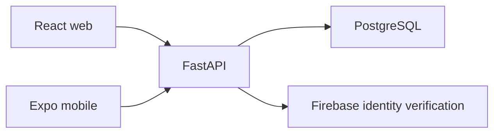

# Backend

FastAPI serves the web and mobile apps. PostgreSQL is the only application database. Firebase verifies identities; Stripe, Daily and OpenAI provide optional external services.

## Layout

| Path            | Responsibility                                              |
| --------------- | ----------------------------------------------------------- |
| `app/main.py`   | Application creation and route registration                 |
| `app/core/`     | Startup, Firebase, middleware and safe database errors      |
| `app/routes/`   | HTTP and WebSocket endpoints grouped by feature             |
| `app/services/` | Business rules and database operations                      |
| `app/models/`   | SQLAlchemy tables and relationships                         |
| `app/schemas/`  | Validated requests and explicit response fields             |
| `app/database/` | PostgreSQL pool and verified legacy schema adoption         |
| `migrations/`   | Ordered, versioned schema changes                           |
| `scripts/`      | Deployment preparation, data import and administrator setup |

Import dependencies from their specific modules. `app/models/__init__.py` registers every table for relationships and Alembic. Add schema changes in a new revision; never change an already applied migration.

## Database architecture



The application has 33 tables, grouped by purpose:

| Records                         | Storage and ownership                                                                                                                |
| ------------------------------- | ------------------------------------------------------------------------------------------------------------------------------------ |
| Accounts and profiles           | `accounts`, `normal_users`, `counsellors`, `admins`                                                                                  |
| Scheduling and clinical care    | `counsellor_availability`, `appointments`, `counselling_sessions`, `prescriptions`                                                   |
| Payments                        | `user_payments`, `user_refunds`, `counsellor_payments`, `user_wallets`                                                               |
| Conversations and notifications | `chat_sessions`, `chat_turns`, `direct_messages`, `notifications`                                                                    |
| Personal tracking               | `mood_tracking`, `journal_entries`, `sleep_tracking`, `user_medications`, `user_goals`, `biofeedback_telemetry`, `exercise_progress` |
| Published content and results   | `assessment_questions`, `assessment_results`, `disorders`, `exercises`                                                               |
| Community                       | `support_groups`, `community_posts`, `counsellor_reviews`                                                                            |
| Operations                      | `crisis_logs`, `flagged_content`, `contact_submissions`                                                                              |

Ownership, timestamps, money and references use typed columns. JSONB holds variable arrays such as question options and instructions. `imported_data` retains original fields for reconciliation and is excluded from API responses. Existing opaque record IDs remain usable; new feature records use UUID strings. Neither client connects to the database directly.

`accounts` supplies a common foreign key for records that support all three roles, including assessment results. Profile insert triggers register each identity inside the same transaction and prevent IDs from belonging to different roles. Existing profile IDs and authentication flows are preserved. Registry entries remain after profile removal to retain audit ownership.

Patient tracking references `normal_users`. Posts reference groups; exercise progress references exercises; reviews reference the appointment and its exact patient/counsellor pair. New public reviews require a completed appointment. Unverified imported reviews remain private. Foreign keys prevent deletion that would orphan records; retention and account erasure need a separate, explicit workflow.

Chat turns have unique positions within their session. A short row lock makes each turn and its session count commit together. The connection is released while waiting for inference. Streamed replies persist only after successful completion. SQL expressions make habit updates and reaction counts atomic under concurrent requests.

## Configuration

Create `backend/.env` locally and configure the same settings on the server:

- `DATABASE_URL`: PostgreSQL URL with the provider's TLS options.
- `FIREBASE_PROJECT_ID`, `FIREBASE_CLIENT_EMAIL`, `FIREBASE_PRIVATE_KEY`: server service account credentials. Escaped `\n` sequences are accepted in the key.
- `SECRET_KEY`: randomly generated API session signing key.

Production needs `ENVIRONMENT=production`, explicit HTTPS `CORS_ALLOWED_ORIGINS`, and `ALLOWED_HOSTS` containing the API hostname. `FRONTEND_BASE_URL` may supply the web origin. Production signing keys require at least 32 bytes for HS256, 48 for HS384, or 64 for HS512.

| Optional feature | Settings                                                               |
| ---------------- | ---------------------------------------------------------------------- |
| Video            | `DAILY_API_KEY`, optional `DAILY_BASE_URL`                             |
| Payments         | `STRIPE_SECRET_KEY`, `STRIPE_PUBLISHABLE_KEY`, `STRIPE_WEBHOOK_SECRET` |
| Assistant        | `OPENAI_API_KEY`, optional `OPENAI_MODEL`, `OPENAI_MAX_OUTPUT_TOKENS`  |

Defaults and connection limits are in `app/config.py`. Each worker has one bounded async PostgreSQL pool. Migration and import commands use short-lived synchronous connections. Transaction-local timeouts support transaction poolers; preserve TLS options in the URL. A separate migration job may use the provider's direct URL while the API uses its pooled URL.

### OpenAI assistant

Create an API key in your [OpenAI project](https://platform.openai.com/api-keys), then set these values in `backend/.env` and the Render backend environment:

```dotenv
OPENAI_API_KEY=your-server-api-key
OPENAI_MODEL=gpt-6-luna
OPENAI_MAX_OUTPUT_TOKENS=2048
```

The backend uses the official [Responses API](https://developers.openai.com/api/docs/guides/streaming-responses) for ordinary and streamed replies. `OPENAI_MODEL` can select another Responses-compatible text model available to your API project. Requests omit sampling parameters so reasoning models can also be selected. API billing and model access belong to that OpenAI project.

`CHATBOT_SYSTEM_PROMPT` controls assistant instructions. `MAX_TOTAL_TOKENS` limits approximate input history; `OPENAI_MAX_OUTPUT_TOKENS` separately caps generated output, including reasoning tokens when applicable. Recent SQL conversation pairs supply context. Requests set `store=false`; this disables response-history storage and does not establish zero data retention. See [OpenAI data controls](https://developers.openai.com/api/docs/guides/your-data) before sending sensitive records.

Keep the API key only on the backend, outside Git. Missing credentials disable chat with a generic 503 response while other API features can still start. Streams persist only after a completion event; provider failures, truncation and disconnected streams never save partial replies.

## Run locally

From `backend`:

```powershell
python -m venv venv
.\venv\Scripts\Activate.ps1
python -m pip install -r requirements.txt
python -m scripts.prepare_deploy
uvicorn app.main:app --reload --host 127.0.0.1 --port 8000
```

Preparation applies Alembic migrations without inserting demonstration content. Startup verifies the current SQL revision and initializes Firebase. `/health/live` checks the process; `/health/ready` checks initialization and PostgreSQL connectivity. Production API documentation requires `ENABLE_API_DOCS=true`.

## Existing PostgreSQL deployments

Back up the database and verify restoration before changing its schema. Preview adoption of an unversioned older deployment with:

```powershell
python -m scripts.adopt_legacy_postgres
```

For that deployment, apply the reviewed repair and remaining migrations:

```powershell
python -m scripts.prepare_deploy --adopt-legacy
```

`app/database/legacy_schema.py` compares the complete catalog with the frozen baseline in a temporary reference schema. It only repairs the 18 reviewed nullable column omissions. Other differences stop preparation. Repairs and baseline recording are atomic; later runs skip adoption when a revision already exists. Duplicate bookings, malformed profile JSON and inconsistent records require explicit reconciliation, without deleting data to make migration succeed.

Revision `20261017_0003` adds the remaining feature tables and backfills account identities. It preserves existing SQL records. Cross-role ID collisions stop migration. Destructive downgrade is disabled; use a verified backup and the prior deployment for rollback.

## Backups and recovery

Keep database dumps and source archives outside the repository. Verify a full restoration on an isolated PostgreSQL instance before relying on a backup. The completed cutover importer is retained in Git history; normal deployment now only applies Alembic migrations.

Pause application writes before restoring a database. After restoration, deploy the matching API revision, check `/health/ready`, and verify account access and conversation history before resuming writes. Reverting after new writes requires reconciling those writes too.

## Render

Set **Root Directory** to `backend`.

The backend automatically trusts its own hostname from Render's `RENDER_EXTERNAL_HOSTNAME` setting. Keep `ALLOWED_HOSTS` for additional custom domains; values are hostnames without a scheme or path. Requests for unrelated hosts remain rejected. Set `ENVIRONMENT=production` and the explicit web origins described above. Use `/health/ready` as the Render health check path.

For the existing deployment, use this **Build Command**:

```bash
python -m pip install -r requirements.txt && python -m scripts.prepare_deploy --adopt-legacy
```

For a new empty database, omit `--adopt-legacy`. Use this **Start Command**:

```bash
uvicorn app.main:app --host 0.0.0.0 --port $PORT --workers 1 --ws-max-size 65536 --ws-max-queue 16
```

Paid services may run preparation in **Pre-Deploy Command**, with dependency installation in **Build Command**. Preparation must finish before Uvicorn starts. Runtime startup verifies the schema without changing it. Migration credentials need DDL rights; the runtime role can use narrower access, including the insert permission on `accounts` needed by profile registration.

Keep one worker while WebSocket broadcasts and rate limits are process-local. Idle sockets release SQL connections and close when tokens expire. Multiple devices may keep independent sockets. Updated clients send credentials in handshake headers; older query-token clients remain compatible with ASGI query redaction. Proxy logs for older clients need separate redaction.

## Security boundaries

The API reloads roles and approval from PostgreSQL, scopes personal records to the authenticated owner, verifies clinical relationships, and verifies Stripe payments server-side. Response fields exclude private import metadata; moderation lists exclude support notes; anonymous posts exclude account IDs. Database failures return generic messages without SQL parameters. Invalid configuration hides input values.

Paid cancellation, wallet top-ups, voice analysis and account erasure remain unavailable until their corresponding settlement, analysis or retention workflows exist. Browser API tokens are accessible to JavaScript in local storage; native sessions use OS-protected storage. Intake drafts stay in tab session storage and are cleared after saving or session changes.

Hosted TLS, database permissions, network rules, backups, restoration and retention require operational verification. Source migration and foreign keys do not establish that a hosted deployment is secure. Applied migrations remain immutable. Revision `20261018_0004` removes the unused local-password and verification-delivery fields from all three profiles, and stops if any of those fields contain values pending archival.

## First administrator

Create and verify the Firebase identity, then link it explicitly:

```powershell
python -m scripts.create_super_admin --email admin@example.com --name "Administrator"
```

The command requires an existing verified Firebase identity and never installs a default password.

## Maintenance commands

Run `npm run check` from the repository root for contract freshness, web lint/build and mobile types. It does not require Docker or connect to a database. Test fixtures and the completed cutover importer are omitted from the application tree.

`python -m scripts.export_openapi` exports the shared client contract using inert configuration without entering the application lifespan or opening hosted connections. Update Pydantic schemas alongside endpoint behavior, then run the root API generator.

Keep `scripts.prepare_deploy` and `scripts.adopt_legacy_postgres`: the existing Render build command calls them. `scripts.create_super_admin` remains the explicit administrator setup command. Applied migrations and their frozen baseline are required to rebuild or verify the database schema.
